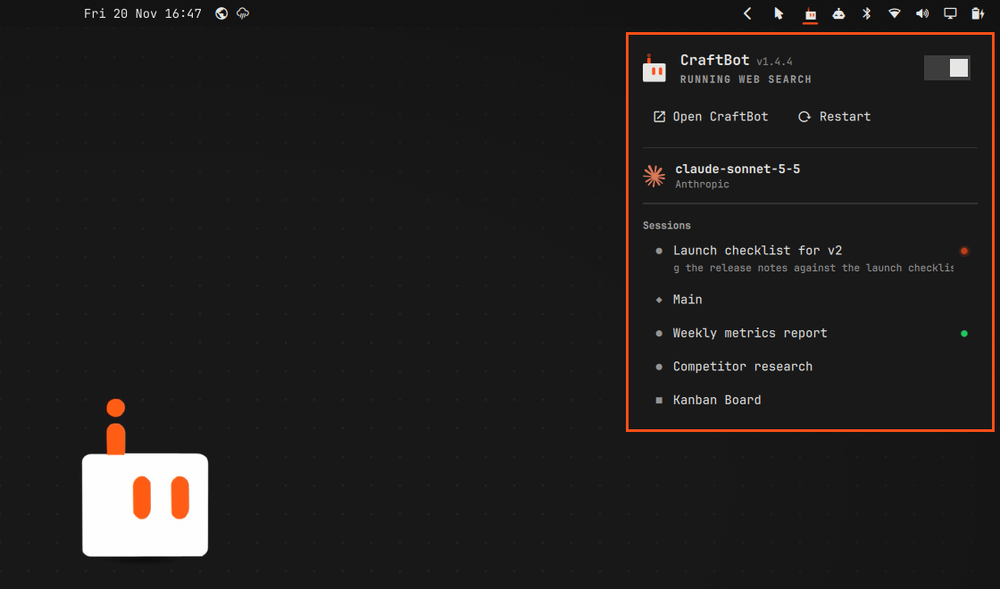

# CraftBot for Omarchy

Hi Omarchian (If that's what they call the users of Omarchy OS), I made this little plugin to show the AI agent harness [CraftBot](https://github.com/CraftOS-dev/CraftBot) in your Omarchy
bar, showing what your local CraftBot agent is doing, with a panel for the
current model, your sessions, and the CraftBot service.



## Install

```bash
omarchy plugin add https://github.com/zfoong/omarchy-craftbot-plugin.git --enable
```

The widget joins the right side of the bar. Move it with
`omarchy bar move craftbot.status --section <left|centerBegin|centerEnd|right>`,
or drag it on the bar.

## Remove

```bash
omarchy plugin remove craftbot.status
```

This removes the plugin and its bar entry. It does not touch CraftBot itself;
uninstall CraftBot with `python3 craftbot.py uninstall` from its folder.

## Requirements

- Omarchy with the Quattro shell (`omarchy plugin` commands).
- `python3` (standard library only) for the live step-status helper.
- CraftBot, running locally. Don't have it? The panel offers **Install
  CraftBot** (see below), which needs `git`, Python 3.8 or newer, and about
  5 GB of disk.

## Using it

- **Left click** opens the panel: the mascot and status, a switch for the
  CraftBot service, **Open CraftBot** and **Restart**, the current model and
  provider, and your sessions. Each session shows CraftBot's sidebar dot
  (orange and pulsing while the agent works in it, green for unread), and
  during a run, the current step's status line from the decision reply
  ("Reading the project README..."), scrolling when it's too long.
- **Right click** opens CraftBot (focusing an existing CraftBot tab or window).
  While CraftBot is offline it opens the panel instead.
- **Middle click** refreshes.
- In the panel: `Enter` or `o` opens CraftBot, `r` refreshes, `Tab` moves to
  the neighbouring panel.
- IPC: `omarchy-shell craftbot.status status|refresh|launch|open|close|toggle`

### CraftBot not running, or not installed

- **Installed but stopped:** the panel offers **Start CraftBot**:
  `systemctl --user start craftbot.service` when the service exists, otherwise
  `python3 craftbot.py start` in the CraftBot folder.
- **Not installed** (nothing answers, no `craftbot.service`, no `craftbot.py` in
  the CraftBot folder): the panel offers **Install CraftBot**. A floating
  terminal runs [`install.sh`](install.sh), which installs CraftBot from source
  the way its README does, but pinned to one exact CraftBot commit (v1.4.4):
  it fetches that commit into `~/CraftBot`, checks it out detached, verifies
  the hash, and runs `python3 craftbot.py install`, which starts CraftBot,
  turns on auto-start and opens it in the browser. The checkout is then put on
  a local `main` branch at the same commit so CraftBot's own updater can update
  it later when you choose to. An existing CraftBot in the folder is started,
  never replaced, and nothing is installed outside your home folder.
- While CraftBot isn't installed, the widget checks once a minute.

## Settings

| Key | Default | |
|---|---|---|
| `apiUrl` | `http://127.0.0.1:7926` | CraftBot backend. Loopback only. |
| `uiUrl` | `http://localhost:7925` | CraftBot UI, opened by right click. Loopback only. |
| `serviceName` | `craftbot.service` | systemd user unit to control. |
| `installDir` | `~/CraftBot` | Where Install puts CraftBot, and where a CraftBot without a service is found. Must be inside your home folder. |

```bash
omarchy bar set craftbot.status installDir ~/apps/CraftBot
```

CraftBot moves to the next free ports when 7925/7926 are taken and records the
real ones in `<CraftBot folder>/ui.json`. The widget reads that file (the folder
comes from the service's `--state-root`, else `installDir`), so the URLs only
need setting for something unusual.

## How it works

- **Status:** polls `GET <apiUrl>/api/state` with XMLHttpRequest every 2 s while
  the agent is busy or the panel is open, 5 s when idle, 15 s while offline,
  and 60 s while CraftBot isn't installed. Requests go to loopback addresses
  only; any other URL in the settings falls back to the default.
- **Step status line:** CraftBot sends it only live, on its `/ws` socket, and
  never stores it. While CraftBot is online, [`stream.py`](stream.py)
  (standard-library Python) joins that socket the way CraftBot's own UI does:
  it reads the per-process session token from `/api/session-token`, presents
  CraftBot's UI origin, answers the server's pings, and prints one JSON line per
  status change. The token is never printed or stored. The widget restarts the
  helper on failure, backing off from 5 s to a minute. Note that CraftBot starts
  its soft onboarding when the first client connects, so on a fresh install the
  widget can be that client.
- **Service control:** `systemctl --user start|stop|restart <serviceName>`, run
  with an argument list, never through a shell.
- **Install:** `install.sh` in a floating terminal, as described above.
- Every string from CraftBot is flattened, length-bounded and rendered as plain
  text (`Model.js`).

## External dependencies

- [CraftBot](https://github.com/CraftOS-dev/CraftBot) (MIT), the app this plugin
  shows. The Install button fetches CraftBot v1.4.4 at commit
  `1a9416856840c89f0f4b779311558bddca056600` from GitHub, and CraftBot's
  installer then downloads its own Python and Node.js runtimes and packages.
- `python3`, `git`, `systemctl` (systemd user services), and Omarchy's
  `omarchy-launch-or-focus-webapp` and
  `omarchy-launch-floating-terminal-with-presentation`.
- Provider icons from Omarchy (MIT); see
  [THIRD_PARTY_NOTICES.md](THIRD_PARTY_NOTICES.md).

## Developing

Saving a file reloads the plugin, but a widget already placed in the bar keeps
its compiled QML until the shell restarts: run `omarchy restart shell` after
editing `.qml`/`.js` files (the i18n JSON is read live).

```bash
node tests/model.test.mjs [path/to/state.json]

# A stand-in CraftBot backend (state, token, /ws with pings and scripted messages):
python3 tests/fake_craftbot.py 7995 state.json script.jsonl --gap 0.3 &
python3 stream.py http://127.0.0.1:7995
```

## License

MIT © 2026 CraftOS. See [LICENSE](LICENSE) and
[THIRD_PARTY_NOTICES.md](THIRD_PARTY_NOTICES.md).
